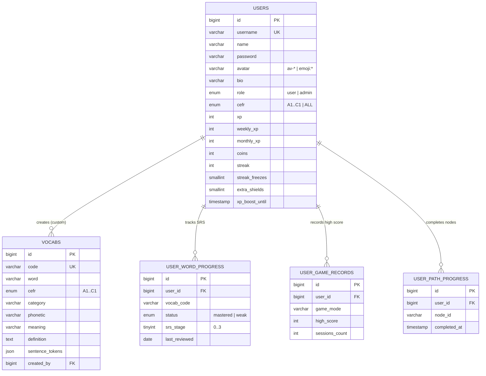

# Dokumentasi Arsitektur & Basis Data — Vocaplay

Dokumen ini merangkum arsitektur sistem, skema relasi basis data (ERD), lapisan keamanan, dan endpoint REST API untuk **Vocaplay — Learn and Fun**.

---

## 1. Gambaran Arsitektur Sistem

Vocaplay menggunakan arsitektur **Full-Stack Laravel + MySQL** dengan *fallback* lokal (`localStorage`) saat offline:

* **Frontend**: HTML5, Tailwind CSS v3 (build lokal ke `css/tailwind.css`), HTML5 Canvas 60fps (*Penembak Kata*), Web Audio API, Web Speech API (TTS & Speech Recognition), dan Service Worker (*network-first* untuk aset statis, tanpa caching pada `/api/*`).
* **Backend API**: Laravel 11/12 + Laravel Sanctum (Bearer Token) + Hash Bcrypt sisi server.
* **Database**: MySQL (`vocaplay_db` untuk aplikasi, `vocaplay_test` khusus untuk automated testing).
* **Caching Korpus**: Endpoint `GET /api/vocabs?all=1` menyimpan 4.000+ kata di `Cache::store('file')` selama 10 menit agar tidak menabrak batas `max_allowed_packet` MySQL.

---

## 2. Entity Relationship Diagram (ERD MySQL)

---

## 3. Lapisan Keamanan

1. **Autentikasi & Password**: Password asli dikirim ke server dan di-hash menggunakan `Hash::make()` (bcrypt). Token Sanctum lama dicabut setiap login baru.
2. **Rate Limiting**:
   * Login dibatasi maksimal **5 percobaan gagal/menit** per kombinasi `username + IP` (HTTP `429`).
   * Seluruh endpoint dilindungi middleware `throttle` per IP.
3. **Anti-Cheat Progres (`VocaplayController::saveProgress`)**:
   * Kenaikan XP dibatasi berdasarkan durasi waktu sejak sinkronisasi terakhir (`400 + 200/menit`, batas mutlak `3000`).
   * `weekly_xp` dan `monthly_xp` mengikuti batas kenaikan `xp` total; `streak` maksimal naik `+1` per sinkronisasi; `total_correct` tidak boleh melebihi `total_answered`.
   * Jika klien mengirim nilai di luar batas wajar, server mengembalikan `clamped: true` dan klien menyesuaikan tampilan ke nilai otoritatif server.
4. **Sanitasi XSS & Input**:
   * Server menghapus tag HTML pada `name` dan `bio`, membatasi ukuran `profile_meta`, serta memvalidasi `avatar` hanya ke pola `av-*` atau `emoji:*`.
   * Klien menggunakan helper `escapeHtml()` sebelum merender data pengguna ke DOM serta memvalidasi skema URL gambar.

---

## 4. Ringkasan Endpoint REST API (Laravel)

| Method | Endpoint | Middleware | Fungsi |
|---|---|---|---|
| `POST` | `/api/register` | `throttle:5,1` | Pendaftaran akun baru (bcrypt + token Sanctum) |
| `POST` | `/api/login` | `throttle:20,1` + 5/min per user | Autentikasi akun & penerbitan token |
| `GET` | `/api/leaderboard?period=weekly` | `throttle:60,1` | Mengambil 50 peringkat teratas (*weekly / monthly / alltime*) |
| `GET` | `/api/vocabs?all=1` | `throttle:60,1` | Mengambil seluruh korpus kosakata (file-cached 10 menit) |
| `GET` | `/api/vocabs?cefr=A1&q=...` | `throttle:60,1` | Pencarian & paginasi korpus kosakata |
| `POST` | `/api/progress` | `auth:sanctum`, `throttle:60,1` | Sinkronisasi profil, XP, Diamonds, streak, & metadata belajar |

---

## 5. Strategi Pengujian Otomatis

* **Laravel Feature Test (`laravel-backend/tests/Feature/VocaplayApiTest.php`)**: Menguji registrasi, login, rate limit, migrasi password lama, validasi anti-cheat, leaderboard, dan cache kosakata menggunakan database terpisah `vocaplay_test` (dilengkapi pengaman agar tidak pernah menyentuh `vocaplay_db`).
* **Unit Test JS (`tests/js/state.test.mjs`)**: Menguji `escapeHtml`, sanitasi avatar, hashing, dan normalisasi profil.
* **E2E Smoke Test (`tests/e2e/smoke.spec.js`)**: Membuka seluruh 9 game, 6 tab navigasi, toggle tema, dan modal Edit Profil di Chromium via Playwright untuk memastikan nol error runtime JavaScript.
